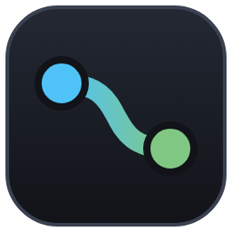
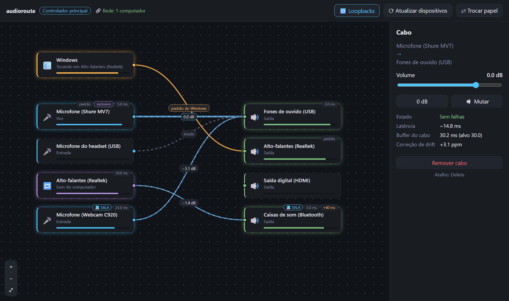

# audioroute

Roteador de áudio para Windows com **latência de estúdio**. Ligue qualquer entrada (microfone, o som
que toca numa saída) a qualquer saída (fone, caixa de som) desenhando cabos num canvas, inclusive
entre computadores da mesma rede.



- **Cabos virtuais** com ganho, mudo e mixagem: vários microfones numa saída, um microfone em
  várias saídas.
- **WASAPI direto**: modo compartilhado de baixa latência ou **exclusivo** (5 ms por padrão), por
  dispositivo.
- **Compensação de drift**: cada cabo acompanha a diferença de relógio entre os dois dispositivos e
  reamostra, sem estalos nem atraso crescente.
- **Atraso por dispositivo** para alinhar caixas em lugares diferentes.
- **Som do Windows**: um cabo fixo leva o som de todos os programas à saída que você escolher (troca
  a saída padrão do sistema).
- **Rede local**: o computador "participante" é encontrado sozinho, e os dispositivos dele aparecem
  no canvas do "controlador principal".
- **Um arquivo só**: `audioroute.exe` (~1 MB), sem instalador. Fechar a janela deixa o app na
  bandeja, com o áudio rodando.

## Requisitos

- Windows 10 ou 11 (64 bits)
- [Microsoft Edge WebView2 Runtime](https://developer.microsoft.com/microsoft-edge/webview2/) (já
  vem no Windows 11 e na maioria dos Windows 10)

## Uso

1. Baixe o `audioroute.exe` em **Releases** e abra.
2. Escolha **Controlador principal**.
3. Arraste do conector à direita de uma entrada 🎤 até o conector à esquerda de uma saída 🔊.
4. Clique num cabo para ajustar o volume, ou num dispositivo para escolher modo, período e atraso.

### Em rede

1. Em outro computador da mesma rede, abra o `audioroute.exe` e escolha **Participante**.
2. Ele conecta sozinho ao controlador; os dispositivos dele aparecem no canvas com o nome do
   computador. Se a rede bloquear a busca automática, digite no participante o endereço que o
   controlador mostra no topo da tela (ex.: `192.168.0.10`).
3. Na primeira vez, o Firewall do Windows pergunta se o app pode usar a rede: permita em **redes
   privadas** nos dois computadores.

Portas usadas: UDP 47800 (descoberta), TCP 47801 (controle) e UDP dinâmica (áudio).

> Ainda não há senha: qualquer audioroute da mesma rede local pode entrar como participante.

## Compilar

Precisa do [Rust](https://rustup.rs) (alvo MSVC) e do Windows SDK (o `rc.exe`, para o ícone).

```bat
build.bat
```

Gera `release\audioroute.exe`. A interface (`app\ui`) é HTML, CSS e JS puros,
embutidos no exe; não há build web.

Para editar a interface sem recompilar, abra o exe com a pasta dela; F5 recarrega e o DevTools fica
liberado:

```bat
set AUDIOROUTE_UI_DIR=%CD%\app\ui
target\debug\audioroute.exe
```

Testes: `cargo test --workspace`.

## Estrutura

```
crates/core      tipos, identidade, config e motor (rotas, mix, drift, reamostrador)
crates/wasapi    backend Windows (WASAPI)
crates/control   fachada usada pela interface
crates/net       rede: descoberta, controle por TCP, áudio por UDP
crates/cli       audioroute-cli: --list, --probe, --measure, rodar um config.json
app/host         janela Win32 + WebView2, bandeja e ponte com a interface
app/ui           interface (canvas)
```

O [PLANO.md](PLANO.md) tem as decisões do projeto e as próximas etapas.

## Licença

[MIT](LICENSE)
